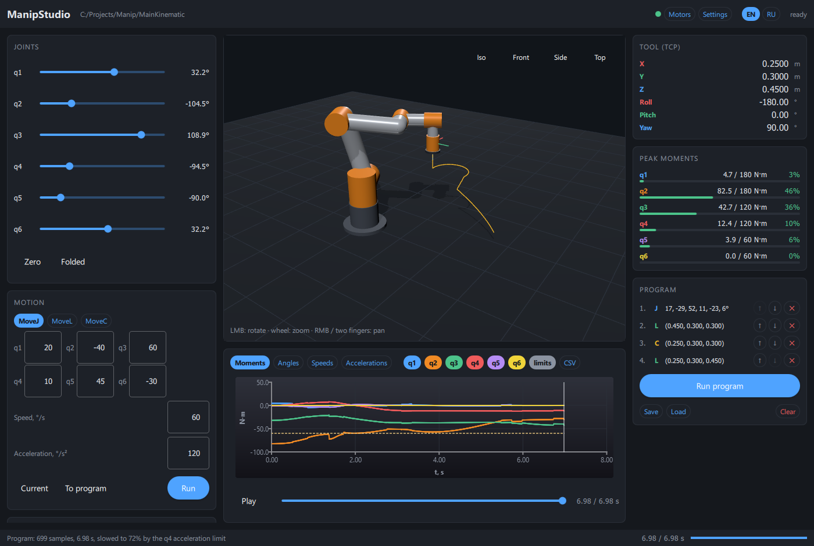

<div align="center">

# ManipStudio

**Model a robot. Plan its motion. See the loads.**

A C++ robotics workbench with an interactive 3D view, trajectory planning,
joint dynamics, and a Qt Quick desktop interface.


[Quick start](#quick-start) · [Features](#features) · [Configuration](#configuration) · [Tests](#tests) · [Русский](README.ru.md)

</div>



ManipStudio brings the robot model, motion commands, and analysis into one window.
Adjust the joints, plan a straight line or a circular arc, then scrub through the
result to inspect the pose and the moments required at each joint.

The repository is named **MainKinematic**; **ManipStudio** is its desktop application.
The current model is a serial robot with **six revolute joints**.

## Features

| Model | Plan | Inspect |
|:---|:---|:---|
| Modified Denavit–Hartenberg geometry | Synchronized **MoveJ** | Interactive 3D view and TCP path |
| Joint angle, speed, and acceleration limits | Straight-line **MoveL** | Joint angles, speeds, and accelerations |
| Link masses, centers of mass, and inertias | Circular **MoveC** through a middle point | Joint moments and peak-load ratios |
| Point-mass payload and mounting plane | TCP jog and programs of J/L/C steps | Timeline playback and CSV export |
| Generated convex collision geometry | Collision and motor-moment checks | English / Russian language switching |

- **Editable model.** Change DH parameters, joint radii, limits, dynamics, and payload in the settings panel. Apply changes in memory or save them to the INI file.
- **Joint-aware planning.** MoveJ respects individual joint limits while staying synchronized. MoveL and MoveC can slow the whole move to meet joint speed and acceleration limits.
- **Shared geometry.** The display and collision hulls use the same generated arm-part description. Joint radii are configurable approximations of the physical robot.
- **Responsive interface.** Planning runs in a worker thread, with playback and analysis in the GUI.
- **Motor test window.** Experimental ODrive CAN Simple support, a simulated bus, live telemetry, and axis setup. Hardware validation is pending; see [Motor testing](#motor-testing).

## Quick start

Run the commands below from the repository root after cloning or downloading it.
A first build downloads GoogleTest unless an installed version is selected.

### Linux / Ubuntu 24.04

Install a C++17 compiler, CMake, and Qt 6.4 or newer. These Ubuntu packages include
the QML modules used by the interface:

```bash
sudo apt update
sudo apt install -y build-essential cmake ninja-build git \
  qt6-base-dev qt6-declarative-dev qt6-quick3d-dev qt6-charts-dev \
  qt6-shadertools-dev libxkbcommon-dev \
  qml6-module-qtquick qml6-module-qtquick-controls \
  qml6-module-qtquick-layouts qml6-module-qtquick-window \
  qml6-module-qtquick-dialogs qml6-module-qtquick-templates \
  qml6-module-qtqml-workerscript qml6-module-quick3d \
  qml6-module-quick3d-helpers qml6-module-qtcharts
```

```bash
cmake -S . -B build -G Ninja -DCMAKE_BUILD_TYPE=Debug
cmake --build build --parallel 8
./build/Studio/ManipStudio --lang en
```

The application loads the model and meshes from the source directory by default.
Qt Quick 3D needs a working graphics backend. WSLg can display the application;
the Qt `offscreen` software backend does not render the 3D viewport.

### Windows / MSYS2 UCRT64

Install [MSYS2](https://www.msys2.org/) and open its **UCRT64** terminal.
Update it with `pacman -Syu`; if prompted to close the terminal, reopen UCRT64
and run the update again. Then install the development packages:

```bash
pacman -S --needed \
  mingw-w64-ucrt-x86_64-gcc \
  mingw-w64-ucrt-x86_64-cmake \
  mingw-w64-ucrt-x86_64-ninja \
  mingw-w64-ucrt-x86_64-qt6-base \
  mingw-w64-ucrt-x86_64-qt6-declarative \
  mingw-w64-ucrt-x86_64-qt6-quick3d \
  mingw-w64-ucrt-x86_64-qt6-charts \
  mingw-w64-ucrt-x86_64-qt6-shadertools \
  mingw-w64-ucrt-x86_64-gtest
```

From the repository root in that same terminal:

```bash
cmake -S . -B build-win -G Ninja -DCMAKE_BUILD_TYPE=Debug \
  -DMANIP_SYSTEM_GTEST=ON
cmake --build build-win --parallel 8
./build-win/Studio/ManipStudio.exe --lang en
```

Launch from UCRT64 so Qt DLLs are on `PATH`. A standalone Windows distribution
with bundled dependencies is not provided yet. The Windows build has been tested
with MinGW-w64; MSVC and macOS have not been validated.

## Try a motion program

The included example runs **MoveJ → MoveL → MoveC → MoveL**:

```bash
./build/Studio/ManipStudio --lang en \
  --program "$PWD/Studio/examples/demo_program.json"
```

In the interface:

1. Use the joint sliders or the **Zero / Folded** presets to choose a start pose.
2. Select **MoveJ**, **MoveL**, or **MoveC** and enter the target. **Current** copies the current values.
3. Choose **Run**, or add the command **To program** and run several steps together.
4. Inspect the TCP path and plots. Pause playback or drag the timeline to examine a pose.
5. Use **CSV** to export sampled joint states and moments. Save/load programs as JSON.

Each program step is planned as a separate rest-to-rest move. The sequence is
combined into one timeline; corner blending between steps is not implemented.

<details>
<summary><strong>Program format</strong></summary>

```json
{
  "format": "ManipStudio program",
  "version": 1,
  "steps": [
    {"type": "J", "joints": [17, -29, 52, 11, -23, 6], "speed": 60, "accel": 120},
    {"type": "L", "pose": [0.45, 0.30, 0.30, 180, 0, 90], "speed": 0.15, "accel": 0.6},
    {"type": "C", "mid": [0.35, 0.42, 0.30], "pose": [0.25, 0.30, 0.30, 180, 0, 90], "speed": 0.15, "accel": 0.6}
  ]
}
```

Joint angles and pose orientation use **degrees** in the GUI and program files.
Positions use **meters**. A pose is `[x, y, z, roll, pitch, yaw]` with ZYX Euler
orientation. MoveJ speed/acceleration use °/s and °/s²; translational MoveL/MoveC
use m/s and m/s². A pure MoveL reorientation uses rad/s and rad/s² internally.

The full example is in [Studio/examples/demo_program.json](Studio/examples/demo_program.json).

</details>

<details>
<summary><strong>Command-line options</strong></summary>

| Option | Purpose |
|:---|:---|
| `--data <dir>` | Directory containing `ManipulatorSettigns.ini` and `STLmodels/` |
| `--lang en` / `--lang ru` | Select the interface language |
| `--joints q1,...,q6` | Set initial joint angles, in degrees |
| `--movej q1,...,q6` | Plan and play a MoveJ after loading |
| `--program <file.json>` | Load and run a motion program |
| `--settings` | Open the model settings panel |
| `--motors` | Open the motor test window |
| `--motor-sim` | Open the motor window and connect to simulated ODrive axes |
| `--screenshot <file.png>` | Save the window after loading or finishing the requested move, then exit |

For example, save a screenshot of the demo:

```bash
./build/Studio/ManipStudio --lang en \
  --program "$PWD/Studio/examples/demo_program.json" \
  --screenshot "$PWD/demo.png"
```

</details>

## Configuration

The model is stored in [ManipulatorSettigns.ini](ManipulatorSettigns.ini)
(the historical filename is retained). Open **Settings** to edit it:

| Panel | Parameters |
|:---|:---|
| **Kinematics** | Modified DH table and joint radii for display/collision geometry |
| **Limits** | Joint travel, maximum speed, acceleration, moment, and floor height |
| **Dynamics** | Link masses, centers of mass, inertia tensors, payload mass and location |

**Apply** rebuilds the solver in memory. **Save to file** also writes the INI.
**Reload file** restores the saved model. Applying settings clears the old trajectory.

Core calculations use SI units and radians. DH `alpha` is stored in radians in
the INI, while the `joint limits` group stores angles, speeds, and accelerations
in degrees. The GUI handles these conversions.

Defaults describe the bundled example model, including a **5 kg point-mass
payload**. Dimensions, limits, and dynamics must be adapted to your own robot.

## Tests

Build first, then run all registered suites:

```bash
ctest --test-dir build --output-on-failure
```

For Windows, replace `build` with `build-win` and run from UCRT64.
On a Linux machine without a display:

```bash
QT_QPA_PLATFORM=offscreen ctest --test-dir build --output-on-failure
```

| Suite | Coverage |
|:---|:---|
| `ManipTests` | Math, robot model, settings, arm geometry, and GJK |
| `ManipSolverTests` | FK/IK, motion profiles, dynamics, joint limits, collisions, emulator, and shared memory |
| `PhysicsLibTests` | Public library API and conversions |
| `StudioTests` | GUI backend, settings, playback, programs, charts, and export |
| `StudioSceneTests` | Display geometry and its agreement with the core model |
| `StudioI18nTests` | Language switching and translation coverage |
| `MotorTests` | CAN messages, SLCAN framing, simulated drives, and motor-control scenarios |

Tests include independent forward-kinematics and dynamics references, as well as
trajectory scenarios with specified initial conditions. Hardware motor tests
use simulation and do not require a CAN adapter.

## Motor testing

The separate **Motors** window provides experimental ODrive CAN Simple support:
axis configuration, enable/disable, jog, position moves, and live position,
speed, and current plots. Try it without hardware:

```bash
./build/Studio/ManipStudio --motor-sim
```

Real transports are optional: Qt **SerialPort** enables SLCAN adapters over a COM
port; Qt **SerialBus** enables installed CAN plugins such as SocketCAN or PCAN.
Install `qt6-serialport-dev qt6-serialbus-dev` on Ubuntu, or
`mingw-w64-ucrt-x86_64-qt6-serialport` and
`mingw-w64-ucrt-x86_64-qt6-serialbus` on MSYS2.
Axis setup is saved separately in `Motors.ini` under the data directory.

**Real ODrive hardware has not been validated.** GUI stop and link monitoring
are software features; hardware emergency stop and drive watchdog configuration
are required for physical testing. Planned robot programs are not connected to
the motor test controls.

## Project layout

```text
Studio/          Qt Quick application, backend, motor tools, and GUI tests
Tests/           Core unit and trajectory scenario tests
STLmodels/       Mesh assets, including the obstacle
PhysicsLibrary/  Separate shared-library build and compatibility header
armshape.*       Generated arm geometry and convex collision hulls
solver.*         Kinematics, trajectory planning, dynamics, and collision checks
robo.*           Robot model and settings persistence
my_math.*        Math primitives and numerical routines
```

<details>
<summary><strong>Build options</strong></summary>

| CMake option | Default | Purpose |
|:---|:---:|:---|
| `MANIP_BUILD_STUDIO` | `ON` | Build the GUI when the required Qt6 modules are available |
| `MANIP_BUILD_TESTS` | `ON` | Build the three core GoogleTest executables |
| `MANIP_SYSTEM_GTEST` | `OFF` | Use an installed GoogleTest instead of fetching v1.14.0 |
| `MANIP_QT_MAJOR` | automatic | Prefer Qt6; set `5` to build the core with Qt5 |
| `MANIP_WITH_CUDA` | `OFF` | Include legacy CUDA helpers in the console target |
| `MANIP_DATA_DIR` | source directory | Default data directory for Studio |

The GUI also registers its own QtTest suites when built. The core-only console
check can be built without Quick3D, Charts, or GoogleTest:

```bash
cmake -S . -B build-core -DMANIP_BUILD_STUDIO=OFF -DMANIP_BUILD_TESTS=OFF
cmake --build build-core --parallel 8
(cd build-core && ./MainKinematic)
```

With Qt5 installed, add `-DMANIP_QT_MAJOR=5` for a Qt5 core build.

</details>

## Current scope

- Six revolute joints; configurable joint counts and prismatic axes are future work.
- Cartesian motion orientation uses Euler interpolation; quaternion SLERP is planned.
- Collision checks use approximate convex geometry at sampled poses, rather than continuous collision detection.
- The payload model is a point mass. Cartesian contact forces are not calculated.
- Tested development environments: Linux/WSL with Qt 6.4 and Windows/MSYS2 UCRT64 with Qt 6.11; the core also builds with Qt 5.15.

## Contributing

Bug reports with the model settings, starting pose, command/program, and expected
result are especially useful. For code changes, include a regression scenario
where behavior changes and run the relevant test suites. Keep physical-drive
validation separate from simulator results.

## License

A project license has not been selected yet. No open-source license grant is
currently provided; the repository should not be assumed to be MIT- or GPL-licensed.
